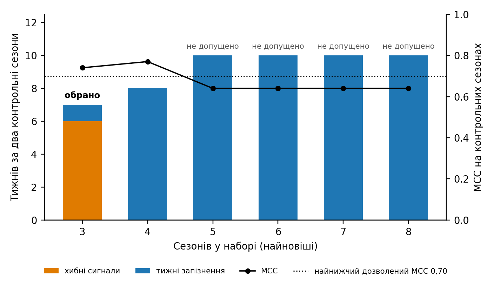
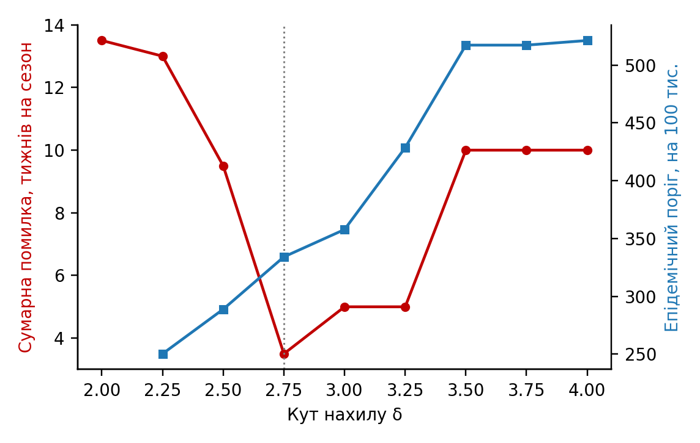
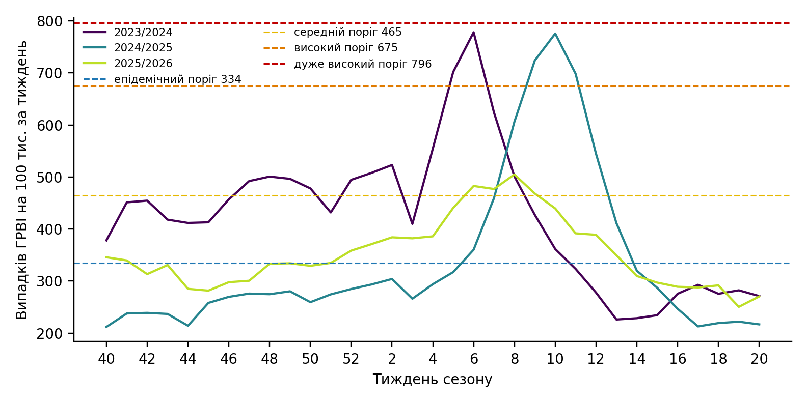
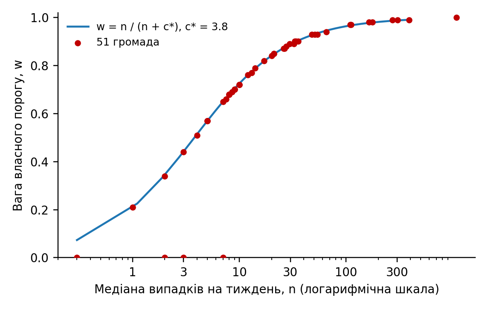

# Порогові значення методу рухомої епідемії для районів і територіальних громад після зміни умов нагляду: добір сезонів за контрольними сезонами, зважене поєднання з порогом району і умова за районом

Сергій Грабовий. Сумська область, Україна. Листування: sergii.grabovyi@gmail.com

Текст підготовлено автором разом із ШІ-асистентом Claude (Anthropic). Усі числа отримано з розрахунку інструментом memopt і відтворюються його запуском; усі посилання звірено з повними текстами джерел.

## Анотація

**Передумови.** Метод рухомої епідемії (MEM) є стандартом для побудови епідемічних порогів і рівнів інтенсивності в нагляді за грипом і гострими респіраторними вірусними інфекціями (ГРВІ). В Україні цей метод стикається з двома новими труднощами. Після початку повномасштабної війни змінились населення, мережа медичних закладів і звернення по допомогу, тому довоєнні сезони вже не завжди описують нинішню ситуацію. Крім того, після адміністративної реформи основною одиницею реагування стала територіальна громада, для якої є лише три сезони даних, а тижнева кількість випадків часто не перевищує десяти.

**Методи.** Для 16 основних територій Сумської області (область, п'ять районів, ті самі райони без міста-центру, п'ять міст) набір сезонів і кут нахилу MEM добирали за сумою хибних сигналів і тижнів запізнення на двох контрольних сезонах нинішнього періоду (2024/2025 і 2025/2026). Довший набір із довоєнними сезонами допускався, лише якщо він не гірше розрізняв епідемічні і неепідемічні тижні за коефіцієнтом кореляції Метьюза. Для 51 громади порівняли вісім способів побудови порогу на відкладених сезонах; обраний спосіб поєднує власний поріг громади з порогом її району, перерахованим на рівень громади, з вагою, що зростає з кількістю випадків. Для 28 найменших громад запропоновано умову за районом: рівень «середній» і вище показується лише тоді, коли район не нижче свого епідемічного порогу.

**Результати.** Для області обрано набір із трьох сезонів нинішнього періоду і кут 2,75 (епідемічний поріг 334 на 100 тисяч за тиждень); набори з п'ятьма і більше сезонами запізнювались на 10 тижнів за два контрольні сезони проти одного. По 16 територіях обрано від трьох до семи сезонів; на контрольних сезонах обрані пороги дали в середньому 0,6 хибного сигналу і 2,0 тижня запізнення на територію за сезон без жодної пропущеної епідемії. Для громад зважене поєднання мало середню сумарну помилку 3,74 тижня на сезон, близьку до найкращої (3,66), і єдине не пропустило жодної епідемії; поріг району без перерахунку пропускав 17,6% епідемій. Умова за районом прибрала 108 із 127 тижнів підвищеного рівня поза епідемією району, зберегла всі 122 тижні під час епідемії і затримала 3 з 47 епізодів на один або два тижні.

**Висновки.** Набір сезонів для порогів MEM після зміни умов нагляду варто добирати перевіркою на сезонах нинішнього періоду, а не за правилом «щонайменше п'ять сезонів». Для громад з кількома випадками на тиждень поріг слід будувати з урахуванням порогу району, а рівень реагування в найменших громадах пов'язувати з епідемією в районі. Підхід реалізовано як відкритий інструмент з щорічним перерахунком без ручних рішень і впроваджено в регіональний дашборд.

## Вступ

Всесвітня організація охорони здоров'я рекомендує визначати початок сезону грипу за перетином сезонного порогу, а рівні інтенсивності за порогами тривоги, і обидва види порогів обчислювати за історичними даними кожної країни, допускаючи, що вони відрізняються між місцевостями всередині країни; серед методів стандарт наводить і метод рухомої епідемії [1]. Метод рухомої епідемії (Moving Epidemic Method, MEM) за кривими минулих сезонів виділяє епідемічний період кожного з них, будує епідемічний поріг за найвищими доепідемічними значеннями і три пороги інтенсивності за найвищими значеннями епідемічних періодів [2, 3]. Метод реалізовано в пакеті mem для R і в застосунку memapp. Автори методу визначили п'ять сезонів як мінімум для стабільних порогів і десять як максимум, щоб лишатися в межах останнього тренду, з виключенням пандемічного сезону і щорічним оновленням [3].

Ця рекомендація виходить з того, що умови нагляду від сезону до сезону приблизно однакові. В Україні після лютого 2022 року це не так. Частина населення виїхала, змінилась мережа закладів і звертання по допомогу, а знаменник показника, населення, відомий лише станом на початок 2022 року. Сезони 2021/2022 і 2022/2023 нетипові через хвилі омікрону і масову міграцію, тому перший сезон нинішнього періоду, з яким можна порівнювати наступні, це 2023/2024. Отже, вимога п'яти сезонів змушує брати довоєнні сезони, а чи допомагають вони порогу в нинішніх умовах, заздалегідь невідомо.

Друга трудність пов'язана з масштабом. Після реформи адміністративного устрою 2020 року практичне реагування на підйом захворюваності (обмежувальні заходи в школах, інформування, посилення нагляду) перейшло на рівень територіальних громад, яких в області 51. Тижневі ряди по громадах існують лише з сезону 2023/2024, а населення громади в медіані становить 8 тисяч осіб. Національний центр статистики охорони здоров'я США не публікує показники життєвої статистики, засновані на менш ніж 20 подіях, бо їхня відносна стандартна похибка становить 23% і більше [4]. У малій громаді різниця між рівнями «низький» і «середній» в окремому тижні лежить у межах випадкового коливання, і пороги, побудовані лише на власних даних громади, запускають реагування там, де епідемії ще немає.

Класичний підхід до оцінок для малих територій полягає в частковому об'єднанні: емпірична байєсівська оцінка території є компромісом між її власною оцінкою і оцінкою за ширшою сукупністю, і для територій з малим числом подій вона наближається до оцінки сукупності [5]. Інший підхід, регіоналізація, жертвує частиною географічної деталізації заради точності, об'єднуючи малі одиниці у більші [6]. Обидва підходи виходять з того, що епідемічний процес у малій території не є незалежним від оточення: епідемії грипу поширюються ієрархічно, найбільші за населенням території мають синхронізовані епідемії, менш населені більш хаотичні, і поширення пов'язане з потоками людей між територіями [7]. Для порогів MEM це означає, що поріг району, у якому лежить громада, несе інформацію про саму громаду.

Мета роботи: запропонувати і перевірити на даних Сумської області (1) спосіб добору набору сезонів і кута нахилу для порогів районів і області, який спирається на сезони нинішнього періоду; (2) спосіб побудови порогів для громад, який поєднує власні дані громади з порогом району; (3) правило показу рівня для найменших громад, яке захищає від хибних сигналів, не приховуючи місцевих підвищень.

## Матеріали і методи

### Дані

Використано щотижневу кількість випадків ГРВІ (включно з грипом і COVID-19 як частиною звітної форми) за даними оперативного моніторингу в Сумській області. Показник у всіх розрахунках це кількість випадків на 100 тисяч населення за тиждень; населення взято станом на 1 січня 2022 року, останнє офіційне перед масовою міграцією.

Основні території (16): Сумська область, п'ять районів (Конотопський, Охтирський, Роменський, Сумський, Шосткинський), ці самі райони без міста-центру і п'ять міст-центрів. Район без центру потрібен тому, що місто-центр дає більшу частину випадків району, і для сільських та селищних громад порівнянною є саме сільська частина району. Ряди основних територій є з сезону 2012/2013. Громади (51): 15 міських, 15 селищних, 21 сільська, населення від 2 988 (Комишанська сільська громада) до 267 046 (Сумська міська громада), медіана 8 114; ряди з 42-го тижня 2023 року. Кожній громаді призначено район-еталон, тобто територію, поріг якої використовується як опора для порогу громади: міським громадам район разом із містом-центром, селищним і сільським район без центру.

Сезон визначено з 40-го по 20-й тиждень (33 тижні). Святкові тижні 52, 1 і 2 в усіх рядах зроблено порожніми, бо через новорічні свята звернень у ці тижні мало і вони спотворюють розрахунок; ці пропуски заповнює функція fill.missing пакета mem, як і в застосунку memapp. Шість сезонів виключено з усіх розрахунків як нетипові: 2015/2016 і 2016/2017 (хвилі пандемічного грипу A(H1N1)pdm09), 2019/2020 і 2020/2021 (пандемія COVID-19), 2021/2022 (хвиля омікрону), 2022/2023 (продовження омікрону, масова міграція, порушення роботи медичної мережі). Нинішнім періодом названо сезони з 2023/2024. Контрольними сезонами названо сезони нинішнього періоду, крім першого: 2024/2025 і 2025/2026. Сезон 2023/2024 до контрольних не належить, бо його початок припав на хвилю COVID-19.

### Пороги MEM

Пороги будували функцією memmodel пакета mem (версія 2.19, R 4.6.1) у стандартних налаштуваннях, тих самих, що за замовчанням у застосунку memapp. Епідемічний період сезону визначали методом нахилу: на кривій накопиченого відсотка випадків межею періоду є точка, де приріст відсотка за тиждень падає нижче параметра δ, який далі називається кутом нахилу [2]. З кожного сезону брали не більше n найвищих доепідемічних значень, де n дорівнює 30, поділеним на кількість сезонів, і епідемічний поріг обчислювали як верхню межу одностороннього 95% інтервалу

$$ Tₑ = x̄ + 1,645 × s, $$

де x̄ і s це середнє і стандартне відхилення цих значень [2]. Пороги інтенсивності (середній, високий, дуже високий) брали з найвищих значень епідемічних періодів у логарифмічній шкалі як верхні межі односторонніх інтервалів рівня 40%, 90% і 97,5% [3]:

$$ T_q = exp(ȳ + z_q × s_y), де y = ln(значення), q = 0,40; 0,90; 0,975. $$

Рівень тижня визначали порівнянням показника з чотирма порогами: нижче епідемічного, низький, середній, високий, дуже високий. Для подальшого важливо, що епідемічний поріг і пороги інтенсивності рахуються з різних наборів значень. Чим вищий кут, тим коротший епідемічний період і тим більше високих тижнів потрапляє до доепідемічних, тож епідемічний поріг росте, а середній поріг майже не змінюється. Якщо епідемічний поріг стає не нижчим за середній, це ознака надто високого кута; автори методу в такому випадку використовують епідемічний поріг як обидва [3].

### Як оцінювали якість порогу

Поріг помиляється двома способами. Хибний сигнал це тиждень поза епідемією, у який показник перевищив поріг. Запізнення це кількість тижнів від початку епідемії до першого перевищення порогу; пропущена епідемія рахується як запізнення на всю її тривалість. Сумарною помилкою названо суму хибних сигналів і тижнів запізнення з однаковими вагами.

Перевірка йшла на відкладених сезонах: контрольний сезон відкладали, пороги будували на решті сезонів набору і рахували помилки у відкладеному [2]. Межі епідемії в контрольному сезоні визначала функція memtiming пакета mem стандартним кутом 2,8 (значення за замовчанням у пакеті) за даними самого сезону, окремо для кожної території. Ці межі не залежать ні від кута, ні від набору сезонів, які перевіряються, тому всі варіанти порівнюються з тими самими межами.

Метод знаходить «епідемічний період» і в майже рівному сезоні. Тому для кожної території один раз будували епідемічний поріг кутом 2,8 за всіма іншими її сезонами, і якщо пік сезону був нижчий за нього, сезон вважали сезоном без епідемії: запізнення в ньому не рахувалось, помилками були лише тижні над порогом, що перевіряється. Як додатковий показник рахували коефіцієнт кореляції Метьюза (MCC) за всіма тижнями контрольних сезонів, тобто наскільки поріг розділяє тижні епідемії і тижні поза нею.

### Добір набору сезонів і кута для основних територій

Для кожної основної території порівнювали набори з найновіших сезонів. Основою був набір з усіх сезонів нинішнього періоду (2023/2024, 2024/2025, 2025/2026); кожен наступний набір додавав ще один старший сезон, аж до всіх доступних (не більше десяти). Для кожного набору окремо обирали кут і рахували сумарну помилку і MCC на контрольних сезонах. Обирали набір з найменшою сумарною помилкою; при рівності з вищим MCC; при рівності обох з п'ятьма і більше сезонами, як рекомендують автори методу [3], далі коротший. Набір, довший за основу, допускався лише тоді, коли його MCC був не нижчий за MCC, який мала б основа з одним додатковим помилковим тижнем. Ця умова потрібна, бо сумарна помилка не враховує правильно класифіковані тижні: довший набір може зменшити помилку за рахунок нижчої чутливості в цілому. Коли сезонів нинішнього періоду стане п'ять, порівнюватимуться набори від п'яти до десяти найновіших сезонів.

Кут перебирали від 2,0 до 4,0 з кроком 0,25, що відповідає діапазону від 2% до 4%, описаному авторами методу, які рекомендують добирати його для кожної країни окремо [2]. Обирали кут з найменшою сумарною помилкою серед допустимих; при рівності вищий, бо він дає менше хибних сигналів у плоских сезонах. Недопустимими вважали кути, при яких епідемічний поріг не нижчий за середній, при яких MCC не більший за нуль, і кути нижчі за межу стабільності: рухаючись від 2,8 вниз, межею ставав кут, на якому епідемічний поріг падав більш ніж на 20% порівняно з попереднім кроком.

### Пороги для громад

Громади поділили на три групи за медіаною випадків на тиждень: надійні дані (14 і більше, 25 громад), обмежені (від 6 до 13, 16 громад), ненадійні (до 5, 10 громад). Межі 6 і 14 випадків обрано як робочі. Громада має лише три сезони, тобто три перевірки на кожен кут, тому кут обирали для групи за тією самою сумарною помилкою, усередненою по всіх громадах групи (від 30 до 75 перевірок на кут). Кут групи був вихідним, але не остаточним: для кожної громади брали найвищий кут, не вищий за кут групи, при якому епідемічний поріг нижчий за середній. Якщо умова не виконувалась при жодному куті від 2,0 до кута групи, власний поріг громади вважали непридатним.

Поріг району переносили на громаду через коефіцієнт масштабу

$$ k = Σ h_t / Σ r_t, $$

де h_t і r_t це показники громади і району-еталона на 100 тисяч у тиждень t, а сума береться за спільні тижні всіх сезонів. Порівняли вісім способів: (1) власний поріг MEM громади; (2) поріг району без перерахунку; (3) поріг району, помножений на k; (4) те саме з k, обчисленим лише за тижнями, коли район вище своєї медіани; (5) перенесення через однакове місце в емпіричних розподілах тижневих значень громади і району; (6) середнє геометричне власного і перерахованого порогів; (7) вибір способу за групою (надійні: власний, обмежені: середнє геометричне, ненадійні: перерахований поріг району); (8) зважене поєднання. Кожен спосіб перевіряли на відкладених сезонах: для кожної громади кожен із трьох сезонів по черзі відкладали, усе (і власний поріг, і поріг району, і k, і параметри поєднання) будували на двох інших, а у відкладеному рахували помилки, разом 153 перевірки на спосіб.

Зважене поєднання побудовано за логікою емпіричної байєсівської оцінки [5] у логарифмічній шкалі:

$$ ln T = w × ln T_власний + (1 − w) × ln(k × T_району),   w = n / (n + c*), $$

де n це медіана випадків громади на тиждень, а c* спільна для всіх громад кількість випадків, при якій власний і перерахований пороги мають рівну вагу. Різниця між власним і перерахованим порогом громади складається зі справжньої особливості громади, яка від кількості випадків не залежить, і випадкової похибки власного порогу, яка тим більша, чим менше випадків. Обидві частини оцінювали регресією квадрата різниці логарифмів порогів по 51 громаді на 1/n, і c* дорівнює їхньому відношенню. Для громади з непридатним власним порогом вага дорівнює нулю.

Перед побудовою порогу громади перші тижні сезону прибирали, якщо вони перевищували медіану наступних восьми тижнів більш ніж на 2,5 медіанних абсолютних відхилення, що відповідає рекомендованому помірно консервативному множнику для виявлення викидів [8]. Так прибираються осінні тижні, завищені через особливості обліку на початку сезону.

### Умова за районом для найменших громад

Умова не змінює порогів, а лише те, який рівень показується: громада показує «середній», «високий» або «дуже високий» лише в ті тижні, коли її район-еталон не нижче свого епідемічного порогу; в інші тижні показується «низький» з позначкою місцевого підвищення, тож інформація не губиться. Умову застосовано до громад, у яких середній поріг відповідає менш ніж 20 випадкам на тиждень (25 громад, межа за критерієм малих чисел [4]), і за рішенням епідеміолога ще до трьох громад з великим відтоком населення і частими хибними сигналами (Кириківська, Грунська, Великописарівська), разом 28.

Для оцінки умови в кожній парі «громада і сезон» визначали період епідемії району, тобто тижні, коли район не нижче свого епідемічного порогу. Тижні з рівнем громади «середній» і вище всередині цього періоду вважали пов'язаними з епідемією, поза ним потенційно хибними. Епізодом називали кілька тижнів поспіль (з розривом не більше одного тижня), коли громада на рівні «середній» і вище; для епізодів, пов'язаних з епідемією району, рахували, на скільки тижнів пізніше за перший тиждень епізоду його показує умова. Оцінювали сезони 2024/2025 і 2025/2026. Як альтернативу перевірено умову за середнім порогом району замість епідемічного.

Як доповнення до умови перевірено інформаційний сигнал «місцевий сплеск» на основі лійкового графіка [9]: очікувана кількість випадків громади дорівнює k × r_t × P / 100 000, де P населення громади; надлишкову дисперсію φ оцінювали за усіченими (10% і 90%) z-відхиленнями [9], а сигнал подавали, якщо спостережена кількість перевищувала межу 99,8% від'ємного біноміального розподілу з цією дисперсією.

Усі розрахунки виконано інструментом memopt (R 4.6.1, пакет mem 2.19; Python 3 для звітів і рисунків). Інструмент щороку після 20-го тижня перераховує набори сезонів, кути, коефіцієнти k, c* і пороги одним запуском без ручних рішень.

## Результати

### Основні території

Для області основа з трьох сезонів дала при куті 2,75 шість хибних сигналів і один тиждень запізнення за два контрольні сезони, сумарна помилка 7, MCC 0,74 (табл. 1, рис. 1). Додавання сезону 2018/2019 підняло епідемічний поріг з 334 до 362: хибних сигналів не стало, але запізнення зросло до 8 тижнів. Набори з п'ятьма і більше сезонами мали поріг від 401 до 408, запізнювались на 10 тижнів і гірше розділяли тижні (MCC 0,64 проти найнижчого дозволеного 0,70), тому до вибору не допускались. Обрано основу з трьох сезонів.

**Таблиця 1. Добір набору сезонів для Сумської області (кут 2,75 для всіх наборів; помилки сумою за два контрольні сезони).**

| Сезонів у наборі | Найстаріший сезон | Епідемічний поріг | Хибних сигналів | Тижнів запізнення | Сумарна помилка | MCC | Допущено |
|---|---|---|---|---|---|---|---|
| 3 | 2023/2024 | 334 | 6 | 1 | 7 | 0,74 | так, обрано |
| 4 | 2018/2019 | 362 | 0 | 8 | 8 | 0,77 | так |
| 5 | 2017/2018 | 401 | 0 | 10 | 10 | 0,64 | ні |
| 6, 7, 8 | 2014/2015 і старші | від 403 до 408 | 0 | 10 | 10 | 0,64 | ні |

По всіх 16 територіях три сезони обрано для 6, чотири для 5, п'ять для 1, шість для 3, сім для 1; умова за MCC відсіяла хоча б один довший набір у 9 територіях. Обрані кути лежать від 2,5 (Конотопський район, м. Конотоп, м. Охтирка, м. Ромни) до 3,25 (Охтирський район, Шосткинський район без центру, м. Шостка), для області 2,75. Для області сумарна помилка на сезон мала виразний мінімум 3,5 при куті 2,75; при 3,0 вона дорівнювала 5,0, при 2,5 9,5, при 3,5 і вище 10,0, бо одна з двох епідемій пропускалась зовсім (рис. 2).

**Таблиця 2. Пороги на сезон 2026/2027 для основних територій (випадків на 100 тисяч населення за тиждень).**

| Територія | Сезонів | Кут | Епідемічний | Середній | Високий | Дуже високий |
|---|---|---|---|---|---|---|
| Сумська область | 3 | 2,75 | 334 | 465 | 675 | 796 |
| Конотопський район | 6 | 2,50 | 411 | 626 | 857 | 984 |
| Конотопський район без центру | 6 | 2,75 | 385 | 524 | 806 | 975 |
| м. Конотоп | 4 | 2,50 | 508 | 663 | 901 | 1032 |
| Охтирський район | 3 | 3,25 | 383 | 485 | 647 | 735 |
| Охтирський район без центру | 3 | 2,75 | 427 | 461 | 635 | 731 |
| м. Охтирка | 7 | 2,50 | 474 | 592 | 740 | 817 |
| Роменський район | 6 | 2,75 | 444 | 582 | 745 | 831 |
| Роменський район без центру | 4 | 3,00 | 408 | 469 | 606 | 679 |
| м. Ромни | 4 | 2,50 | 565 | 693 | 1053 | 1268 |
| Сумський район | 3 | 3,00 | 350 | 495 | 750 | 902 |
| Сумський район без центру | 5 | 2,75 | 271 | 342 | 600 | 769 |
| м. Суми | 3 | 3,00 | 462 | 657 | 959 | 1133 |
| Шосткинський район | 3 | 2,75 | 254 | 354 | 469 | 532 |
| Шосткинський район без центру | 4 | 3,25 | 223 | 254 | 387 | 466 |
| м. Шостка | 4 | 3,25 | 475 | 577 | 777 | 887 |

На двох контрольних сезонах обрані пороги 16 основних територій (32 пари «територія і сезон») дали разом 19 хибних сигналів і 63 тижні запізнення, тобто в середньому 0,6 хибного сигналу і 2,0 тижня запізнення на територію за сезон, без жодної пропущеної епідемії. Серед 32 пар одна визнана сезоном без епідемії: 2025/2026 у Сумському районі без центру, де тижневі показники трималися в межах від 120 до 255 на 100 тисяч, і пік не досяг епідемічного порогу, побудованого за іншими сезонами. Найбільший вплив одного сезону на поріг області мав 2025/2026: без нього епідемічний поріг був би на 9,0% нижчим.

### Громади

Медіана випадків на тиждень у громадах становила 13 (від 0 у Річківській сільській громаді до 1 080 у Сумській міській). Коефіцієнт k був меншим за 1 у 33 громадах, від 0,13 (Краснопільська селищна громада) до 2,78 (Бездрицька сільська громада), медіана 0,80. Одна й та сама епідемія в районі дає в різних громадах показники, які відрізняються у двадцять разів. Для всіх трьох груп обрано кут 3,0: для надійних даних сумарна помилка 3,71 проти 4,43 при 2,75 і 3,80 при 3,25, для обмежених 3,38 проти 3,54 і 3,52, для ненадійних 4,10 проти 4,13 і 5,23. Умова «епідемічний поріг нижчий за середній» при куті групи не виконувалась у 18 громадах: у 14 кут знижено (до 2,75 у 5, до 2,5 у 5, до 2,25 у 4), у 4 (Верхньосироватська, Краснопільська, Річківська, Есманьська) власний поріг непридатний при будь-якому куті. Очищення початку сезону прибрало 14 тижнів у 10 громадах.

**Таблиця 3. Способи побудови порогів для громад на відкладених сезонах (51 громада, 3 сезони, 153 перевірки на спосіб).**

| Спосіб | Поріг не побудовано, % | Хибних сигналів на сезон | Запізнення, тижнів | Пропущено епідемій, % | Сумарна помилка |
|---|---|---|---|---|---|
| Власний поріг | 3,9 | 2,40 | 1,43 | 3,9 | 4,12 |
| Поріг району без перерахунку | 0,0 | 2,34 | 1,57 | 17,6 | 5,92 |
| Поріг району, помножений на k | 0,0 | 2,47 | 1,19 | 1,3 | 3,77 |
| Те саме, k за тижнями високої захворюваності | 0,0 | 2,56 | 1,24 | 1,3 | 3,91 |
| Перенесення через однакове місце в розподілі | 0,0 | 2,18 | 1,22 | 3,3 | 3,66 |
| Середнє геометричне | 3,9 | 2,33 | 1,27 | 3,9 | 3,90 |
| Вибір способу за групою | 2,0 | 2,51 | 1,29 | 2,0 | 3,97 |
| Зважене поєднання | 0,0 | 2,46 | 1,28 | 0,0 | 3,74 |

Найменшу сумарну помилку дало перенесення через однакове місце в розподілі (3,66), зважене поєднання було другим (3,74), поріг району з k третім (3,77); різниця між ними мала порівняно з розкидом між громадами. Зважене поєднання обрано, бо воно єдине не пропустило жодної епідемії і жодного разу не залишило громаду без порогу. Поріг району без перерахунку найгірший: він пропускав приблизно кожну шосту епідемію. Власний поріг у 3,9% перевірок не вдавалося побудувати зовсім.

Оцінене c* дорівнює 3,1 випадку на тиждень (рис. 4). Вага власного порогу була меншою за 0,5 у 7 громадах, від 0,5 до 0,8 у 17, не меншою за 0,8 у 27. Для Сумської міської громади вага 0,997, тобто для міста з тисячею випадків на тиждень поріг практично збігається з власним MEM. Для Новослобідської сільської громади (4 890 мешканців, 3 випадки на тиждень, k = 0,25) вага 0,49: власні пороги 148, 160, 339 і 473 та перераховані пороги району 96, 131, 202 і 244 дають підсумкові 119, 145, 261 і 338. Для Річківської громади з непридатним власним порогом підсумкові пороги дорівнюють порогам Сумського району без центру, помноженим на її k = 0,19: 52, 66, 116 і 148, де 52 на 100 тисяч відповідає двом випадкам на тиждень.

### Умова за районом

Для 28 громад у сезонах 2024/2025 і 2025/2026 визначено 49 пар «громада і сезон». Без умови ці громади мали рівень «середній» і вище у 122 тижнях під час епідемії району і у 127 тижнях поза нею (55 у 2024/2025 і 72 у 2025/2026). Умова зберегла всі 122 тижні під час епідемії району і з 127 тижнів поза нею залишила 19, усі в сезоні 2025/2026, коли район довго тримався поблизу свого порогу. За розміром громади умова прибрала 97% тижнів поза епідемією району в групі до 6 випадків на тиждень, 79% у групі від 6 до 13 і 80% у групі від 14 до 29.

З 47 епізодів, пов'язаних з епідемією району, 44 умова показала без затримки, 2 на тиждень пізніше і 1 на два тижні пізніше (середня затримка 0,09 тижня). У тиждень, коли район перетнув свій епідемічний поріг, або через тиждень чи два рівень отримали 64% епізодів; решта пізніше, бо громада має ще й сама перевищити свій середній поріг. Ще 66 епізодів лежали повністю поза епідемією району, і 43 з них тривали один тиждень. Приклад Новослобідської громади показано на рис. 5: за власними порогами рівень «середній» і вище був у 12 тижнях сезону 2025/2026, з умовою у 4, які припадають на епідемію району.

Умова за середнім порогом району замість епідемічного залишала 8 тижнів поза епідемією району, але 12 із 47 епізодів не показувала зовсім, ще 8 показувала із затримкою і лише 27 без неї. Надлишкова дисперсія тижневих випадків громад відносно очікування від району становила φ = 2,5, тобто коливання приблизно в 1,6 раза більші, ніж передбачає розподіл Пуассона. Сигнал «місцевий сплеск» за межею 99,8% подавався у 8 з 1 848 тижнів (28 громад, два сезони).

## Обговорення

Перший результат стосується набору сезонів. Рекомендація авторів MEM брати щонайменше п'ять сезонів [3] розрахована на ситуацію, коли умови нагляду між сезонами порівнянні. Після 2022 року в Сумській області це не так, і перевірка на сезонах нинішнього періоду показала, що для області і для половини основних територій додавання довоєнних сезонів піднімало поріг і збільшувало запізнення: для області набір з п'яти сезонів запізнювався б на 10 тижнів за два сезони замість одного. Водночас для інших територій (м. Охтирка, Конотопський і Роменський райони) довші набори виявились кращими, тобто рішення залежить від території, і його ухвалює перевірка, а не дослідник. Умова за MCC потрібна як запобіжник: сумарна помилка рахує лише хибні сигнали і запізнення, і без неї довший набір міг би перемогти за рахунок гіршого розділення тижнів у цілому. Коли сезонів нинішнього періоду стане п'ять, процедура автоматично повернеться до рекомендації авторів методу, а вибір між п'ятьма і десятьма сезонами далі робитиме та сама перевірка.

Другий результат стосується громад. Поріг району без перерахунку непридатний, бо рівень захворюваності на 100 тисяч у громадах відрізняється від районного у двадцять разів, і в більшості громад нижчий (k < 1 у 33 з 51). Власний поріг громади на трьох сезонах іноді не будується зовсім, а при надто високому куті епідемічний поріг перевищує середній. Зважене поєднання вирішує обидві задачі: для великих громад воно збігається з власним порогом, для найменших спирається на перерахований поріг району. Це пряма аналогія емпіричної байєсівської оцінки для малих територій [5], тільки об'єднуються логарифми порогів, а роль ширшої сукупності відіграє район, з яким громада пов'язана через ієрархічне поширення епідемій [7]. Перенесення через однакове місце в розподілі дало трохи меншу сумарну помилку, але пропускало 3,3% епідемій; для реагування пропущена епідемія дорожча за хибний сигнал, тому перевагу віддано способу без пропусків. Різниця між трьома найкращими способами мала, і на трьох сезонах її не можна вважати надійною.

Третій результат стосується показу рівня. Умова за районом не змінює порогу, а відкладає рівень реагування, доки епідемія в районі не почалась. На двох сезонах вона прибрала 85% тижнів підвищеного рівня поза епідемією району і не прибрала жодного тижня під час епідемії; ціна становить затримку на один або два тижні в 6% епізодів. Об'єднання малих громад в одну велику, варіант регіоналізації [6], розглядали як альтернативу, але сумарний показник такої групи визначають її найбільші члени, і власні сигнали малих громад губляться. Межа застосування умови, менше 20 випадків на тиждень при середньому порозі, узята з практики статистики життєвих подій [4] і має просту інтерпретацію: нижче неї один тиждень не може надійно відрізнити «середній» рівень від «низького», вище неї власний сигнал громади достатньо надійний, а затримка лише шкодила б. Надлишкова дисперсія φ = 2,5 показує, що хибні перевищення в малих громадах не зводяться до шуму малих чисел: осіннє плато, місцеві хвилі і шкільні спалахи теж дають тижні над порогом. Тому позначка місцевого підвищення лишається видимою, і саме вона дає епідеміологу привід перевірити громаду, навіть коли рівень реагування ще не показується.

Сезон 2025/2026 показав межі самого методу. У плоскому сезоні з високим осіннім плато метод відносить до епідемічного періоду велику частину сезону: для області при стандартному куті 2,8 це 17 тижнів, з 49-го по 13-й. Доепідемічних значень у такому сезоні мало, і поріг, побудований за іншими сезонами, дає хибні сигнали восени: саме на цей сезон припали всі шість хибних сигналів області і всі 19 тижнів, які умова за районом не змогла прибрати. На окремих територіях сезон був майже рівним, і без правила сезону без епідемії програма рахувала б для них «запізнення» епідемії, якої за визначенням MEM не було.

### Обмеження

Контрольних сезонів лише два, і один із них (2025/2026) нетиповий за формою. Набір сезонів і кут обираються і перевіряються на тих самих двох сезонах, тому оцінка якості дещо оптимістична; з кожним новим сезоном вибір ставатиме надійнішим. Пороги області, трьох районів, Охтирського району без центру і м. Суми побудовано на трьох сезонах, тобто нижче рекомендованих п'яти; довші набори для них перевірено, і вони в нинішніх сезонах працювали гірше. Межу стабільності кута 20% перевірено окремим калібруванням на наборі з восьми сезонів; на нинішніх коротших наборах таку перевірку буде можливо повторити, коли сезонів нинішнього періоду стане шість. Для громад усі оцінки орієнтовні, бо спираються на три сезони, один з яких нетиповий, а межі груп 6 і 14 випадків обрано як робочі. Населення 2022 року завищує знаменник у громадах з відтоком людей, тому реальні показники там вищі, а коливання сильніші. Період епідемії району визначається за тими самими даними і тим самим порогом, що перевіряються, тому оцінка «тиждень поза епідемією» не є незалежною істиною. Для чотирьох громад власний поріг непридатний, і їхні пороги повністю залежать від порогу району та коефіцієнта k. Показник охоплює всі ГРВІ, а не лише лабораторно підтверджений грип, тому пороги описують сезонність респіраторних інфекцій загалом.

## Висновки

Після різкої зміни умов нагляду набір сезонів для порогів MEM варто добирати перевіркою на сезонах нинішнього періоду, допускаючи старші сезони лише тоді, коли вони не погіршують розділення епідемічних і неепідемічних тижнів. Для територіальних громад з кількома випадками на тиждень поріг слід будувати зваженим поєднанням власного порогу з порогом району, перерахованим на рівень громади; вага власного порогу визначається кількістю випадків і в наших даних дорівнює половині при трьох випадках на тиждень. Для громад, у яких середній поріг відповідає менш ніж 20 випадкам на тиждень, рівень реагування варто показувати лише після того, як район перетнув свій епідемічний поріг, залишаючи місцеві підвищення видимими як інформаційний сигнал. Підхід реалізовано в інструменті memopt, який щороку перераховує пороги без ручних рішень; пороги передано в регіональний дашборд епіднагляду.

## Подяки

Автор дякує розробникам пакета mem і застосунку memapp за відкритий код, який дозволив відтворити всі обчислення.

## Список літератури

1. World Health Organization. Global epidemiological surveillance standards for influenza. Geneva: World Health Organization; 2013. ISBN 978 92 4 150660 1.
2. Vega T, Lozano JE, Meerhoff T, Snacken R, Mott J, Ortiz de Lejarazu R, et al. Influenza surveillance in Europe: establishing epidemic thresholds by the moving epidemic method. Influenza Other Respir Viruses. 2013;7(4):546-558. doi:10.1111/j.1750-2659.2012.00422.x
3. Vega T, Lozano JE, Meerhoff T, Snacken R, Beauté J, Jorgensen P, et al. Influenza surveillance in Europe: comparing intensity levels calculated using the moving epidemic method. Influenza Other Respir Viruses. 2015;9(5):234-246. doi:10.1111/irv.12330
4. Klein RJ, Proctor SE, Boudreault MA, Turczyn KM. Healthy People 2010 criteria for data suppression. Healthy People Statistical Notes, no. 24. Hyattsville, Maryland: National Center for Health Statistics; 2002. DHHS Publication No. (PHS) 2002-1237.
5. Clayton D, Kaldor J. Empirical Bayes estimates of age-standardized relative risks for use in disease mapping. Biometrics. 1987;43(3):671-681.
6. Spielman SE, Folch DC. Reducing uncertainty in the American Community Survey through data-driven regionalization. PLoS ONE. 2015;10(2):e0115626. doi:10.1371/journal.pone.0115626
7. Viboud C, Bjørnstad ON, Smith DL, Simonsen L, Miller MA, Grenfell BT. Synchrony, waves, and spatial hierarchies in the spread of influenza. Science. 2006;312(5772):447-451. doi:10.1126/science.1125237
8. Leys C, Ley C, Klein O, Bernard P, Licata L. Detecting outliers: do not use standard deviation around the mean, use absolute deviation around the median. J Exp Soc Psychol. 2013;49(4):764-766. doi:10.1016/j.jesp.2013.03.013
9. Spiegelhalter DJ. Funnel plots for comparing institutional performance. Stat Med. 2005;24(8):1185-1202. doi:10.1002/sim.1970
