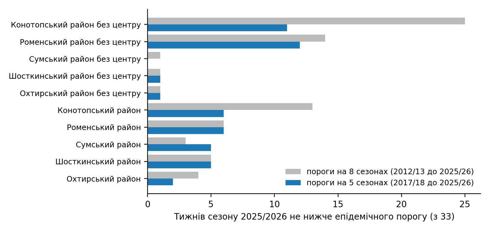

# Порогові значення методу рухомої епідемії для малих територій: часткове об'єднання з районом-еталоном і правило підтвердження районом у нагляді за гострими респіраторними вірусними інфекціями в Сумській області

Сергій Грабовий. Сумська область, Україна. Листування: sergii.grabovyi@gmail.com

Текст підготовлено автором разом із ШІ-асистентом Claude (Anthropic). Усі розрахунки відтворювані з коду інструмента memopt, усі посилання звірено з повними текстами джерел.

## Анотація

**Передумови.** Метод рухомої епідемії (MEM) є стандартом для побудови епідемічних порогів і рівнів інтенсивності в нагляді за грипом і гострими респіраторними вірусними інфекціями (ГРВІ). Для областей і районів він працює надійно, але після адміністративної реформи в Україні основною одиницею реагування стала територіальна громада, для якої є лише три сезони даних, а тижнева кількість випадків часто не перевищує десяти. За таких чисел власні пороги громад спрацьовують хибно або не спрацьовують зовсім.

**Методи.** Для 51 громади Сумської області (населення від 3 до 267 тисяч) ми порівняли вісім способів побудови порогів: власний поріг MEM на трьох сезонах, поріг району-еталона, поріг еталона з коефіцієнтом масштабу k, квантильне відображення, середнє геометричне, правило за групами надійності та часткове об'єднання, у якому вага власного порогу зростає з кількістю випадків за формулою емпіричного Байєса. Кут нахилу для власного порогу громади брали не вище кута її групи і лише такий, при якому епідемічний поріг нижчий за середній. Якість оцінювали на відкладених сезонах за кількістю хибних сигналів і запізненням. Для 16 основних територій (область, п'ять районів, п'ять районів без міста-центру, п'ять міст) кут нахилу MEM підбирали за тим самим критерієм з обмеженням стабільності порогу. Для малих громад додатково запропоновано правило підтвердження районом: рівень «середній» і вище показується лише тоді, коли район-еталон не нижче свого епідемічного порогу.

**Результати.** Часткове об'єднання дало найменшу середню сумарну помилку на відкладених сезонах (2,88 тижня на сезон проти 3,20 для власного порогу і 5,83 для порогу еталона без коефіцієнта) і не мало жодного випадку, коли поріг не вдалося побудувати. Коефіцієнт k коливався від 0,13 до 2,78, тобто рівень захворюваності громад становить від однієї восьмої до майже трьох рівнів району, і без нього перенесення порогу еталона непридатне. Правило підтвердження районом для 28 малих громад зменшило кількість тижнів з рівнем «середній» і вище поза періодом епідемії району з 126 до 8 за два сезони, не змінивши жодного з 95 тижнів усередині періоду епідемії району; запізнення на один тиждень отримали 4 із 37 епізодів. Перехід з восьми на п'ять сезонів для порогів районів-еталонів прибрав систематичне перевищення порогу Конотопського району без центру (з 25 до 11 тижнів сезону 2025/2026).

**Висновки.** Поєднання часткового об'єднання з порогом еталона і правила підтвердження районом дає громадам пороги, які можна використовувати для запуску протиепідемічних заходів, і водночас не приховує місцевих підвищень. Підхід реалізовано як відкритий інструмент і впроваджено в регіональний дашборд.

## Вступ

Всесвітня організація охорони здоров'я рекомендує визначати початок сезону грипу за перетином сезонного порогу, а рівні інтенсивності за порогами тривоги, і обидва види порогів обчислювати за історичними даними кожної країни, допускаючи, що вони відрізняються між місцевостями всередині країни; серед методів усереднення стандарт наводить саме MEM [1]. Найпоширенішим інструментом для цього є метод рухомої епідемії (Moving Epidemic Method, MEM), який за кривими минулих сезонів виділяє епідемічний період кожного з них, будує епідемічний поріг за найвищими доепідемічними значеннями і три пороги інтенсивності за найвищими значеннями епідемічних періодів [2, 3]. Метод реалізовано у пакеті mem для R і в застосунку memapp, і саме так у Сумській області з 2021 року розраховують пороги для області та районів.

Після реформи адміністративного устрою 2020 року практичне реагування на підйом захворюваності (обмежувальні заходи в школах, інформування, посилення нагляду) перейшло на рівень територіальних громад, яких в області 51. Для громад можливі лише три повні сезони спостережень (2023/2024, 2024/2025, 2025/2026), а їхнє населення в медіані становить 8 тисяч осіб. При такому населенні рівень «середній» відповідає кільком випадкам на тиждень: для 17 із 51 громад менш ніж 14 випадкам, для 5 менш ніж 8. Національний центр статистики охорони здоров'я США не публікує показники життєвої статистики, засновані на менш ніж 20 подіях, бо їхня відносна стандартна похибка становить 23% і більше [4]. Тобто для малих громад різниця між рівнями «низький» і «середній» в окремому тижні лежить у межах випадкового коливання, і пороги, побудовані лише на власних даних громади, запускають реагування там, де епідемії ще немає, або не запускають там, де вона є.

Класичний підхід до оцінок для малих територій полягає у частковому об'єднанні: емпірична байєсівська оцінка території є компромісом між її власною оцінкою, загальним середнім і середнім по сусідніх територіях, і для територій з малим числом подій вона наближається до загального середнього [5]. Інший підхід, регіоналізація, жертвує частиною географічної деталізації заради точності, об'єднуючи малі одиниці у більші так, щоб не ламати просторовий малюнок [6]. Обидва підходи виходять із того, що епідемічний процес у малій території не є незалежним від оточення: епідемії грипу поширюються ієрархічно, найбільші за населенням території мають синхронізовані епідемії, а менш населені більш хаотичні, і поширення пов'язане з потоками людей між територіями [7]. Для порогів MEM це означає, що поріг району, у якому лежить громада, несе інформацію про саму громаду, і питання лише в тому, як її правильно перенести.

Мета роботи: побудувати і перевірити на даних Сумської області спосіб розрахунку порогів MEM для громад, який поєднує власні дані громади з даними району-еталона, і доповнити його правилом відображення рівня, що захищає від хибних сигналів у малих громадах, не приховуючи місцевих підвищень.

## Матеріали і методи

### Дані

Використано щотижневу кількість випадків ГРВІ (включно з грипом і COVID-19 як частиною звітної форми) за даними оперативного моніторингу Сумського обласного центру контролю та профілактики хвороб. Показник у всіх розрахунках це кількість випадків на 100 тисяч населення за тиждень. Населення взято станом на 1 січня 2022 року, останнє офіційне перед масовою міграцією; наслідки цього обговорено в обмеженнях.

Основні території (16): Сумська область, п'ять районів (Конотопський, Охтирський, Роменський, Сумський, Шосткинський), ці самі райони без міста-центру і п'ять міст-центрів. Для них є ряди з сезону 2012/2013. Малі території (51 громада): 15 міських, 15 селищних, 21 сільська, населення від 2 988 (Комишанська сільська громада) до 267 046 (Сумська міська громада), медіана 8 114; ряди з сезону 2023/2024. Кожній громаді призначено територію-еталон: міським громадам район з містом-центром, селищним і сільським район без міста-центру, бо рівень захворюваності на 100 тисяч у місті з його щільністю і медичною мережею інший, ніж у сільській частині району.

Сезон визначено з 40-го по 20-й тиждень (33 тижні). Святкові тижні 52, 1 і 2 у всіх рядах зроблено порожніми, бо через новорічні свята звернень у ці тижні майже немає і вони спотворюють розрахунок; ці пропуски заповнює функція fill.missing пакета mem (локальна регресія за сусідніми тижнями), як це робить і застосунок memapp. Із розрахунку основних територій виключено сезони 2015/2016 і 2016/2017 (хвилі пандемічного грипу A(H1N1)pdm09 з нетиповою формою), 2021/2022 (хвиля омікрону) і 2022/2023 (продовження омікрону, масова міграція, порушення роботи медичної мережі). Також не взято три найстаріші сезони 2012/2013, 2013/2014 і 2014/2015: за порівнянням наборів сезонів пороги частини районів-еталонів з ними виходили заниженими для сучасного рівня показників (розділ «Кількість сезонів для еталонів»). У підсумку основні території розраховано на п'яти сезонах: 2017/2018, 2018/2019, 2023/2024, 2024/2025 і 2025/2026. Для 2023/2024 початок сезону накладається на хвилю COVID-19, тому цей сезон бере участь у побудові порогів, але не враховується у висновках щодо правила підтвердження районом.

### Пороги MEM

Для кожної території пороги будували функцією memmodel пакета mem (версія 2.19, R 4.6.1). Епідемічний період сезону визначали методом нахилу (i.method = 2): на кривій накопиченого відсотка випадків, упорядкованих за спаданням, межею періоду є точка, де приріст відсотка за тиждень падає нижче параметра δ, який ми далі називаємо кутом нахилу [2]. З кожного сезону брали не більше n найвищих доепідемічних значень, де n = 30 поділити на кількість сезонів (параметр i.n.max = −1), і епідемічний (базовий) поріг обчислювали як верхню межу одностороннього 95% інтервалу

$$ T_e = \bar{x} + 1{,}645 \cdot s, $$

де x̄ і s це середнє і стандартне відхилення цих значень (i.type.threshold = 5, i.tails = 1). Пороги інтенсивності брали з найвищих значень епідемічних періодів у логарифмічній шкалі (i.type.intensity = 6) як верхні межі односторонніх інтервалів рівня 40%, 90% і 97,5% [3]:

$$ T_q = \exp\left(\overline{\ln y} + z_q \cdot s_{\ln y}\right), \quad q \in \{0{,}40;\ 0{,}90;\ 0{,}975\}, $$

що дає середній, високий і дуже високий пороги; у поточній редакції методу ці рівні інтервалів замінили використовувані раніше 50%, 90% і 95% [2, 3]. Рівень тижня визначали порівнянням показника з чотирма порогами: базовий (нижче епідемічного), низький, середній, високий, дуже високий.

### Вибір кута нахилу для основних територій

Кут нахилу δ перебирали від 2,0 до 4,0 з кроком 0,25, що відповідає діапазону від 2% до 4%, описаному авторами методу, які рекомендують добирати δ для кожної країни окремо за чутливістю і специфічністю [2]. Для кожного кута і кожного сезону поріг будували на решті сезонів і перевіряли на відкладеному: рахували хибні сигнали (тижні до початку епідемічного періоду, у які показник перевищив поріг) і запізнення (тижні від початку епідемічного періоду до першого перевищення; пропущена епідемія зараховується як запізнення на всю її тривалість). «Істинний» початок епідемічного періоду відкладеного сезону визначали за даними самого цього сезону функцією memtiming пакета mem (вона знаходить епідемічний період одного сезону тим самим методом нахилу, що й memmodel) з фіксованим кутом 2,8 (значення за замовчуванням у mem), щоб він не залежав від кута, який перевіряється. Сумарна помилка дорівнює сумі хибних сигналів і запізнення з вагами 1:1, усередненій по сезонах. Обирали кут з найменшою сумарною помилкою серед допустимих. Недопустимими вважали кути, при яких епідемічний поріг не нижчий за середній, коефіцієнт кореляції Метьюза перехресної перевірки memgoodness не більший за нуль, а також кути нижчі за межу стабільності: рухаючись від 2,8 вниз, межею ставав перший кут, при якому епідемічний поріг падав більш ніж на 20% порівняно з попереднім кутом. Межу 20% калібрували вкладеною перехресною перевіркою на наборі з восьми сезонів (128 спроб): сумарна помилка була найменшою саме при 20% (4,45), а різниця між усіма варіантами від 5% до 100% не перевищувала 0,23 при бутстреп-похибці близько 0,37. Чутливість вибору до кута «істини» перевіряли повторним розрахунком при 2,5 і 3,0.

### Пороги для малих територій

Громади поділяли на три групи за медіаною випадків на тиждень: надійні дані (14 і більше, 25 громад), обмежені (від 6 до 13, 16 громад), ненадійні (до 5, 10 громад). Кут нахилу для власних порогів обирали окремо для кожної групи за тим самим критерієм сумарної помилки на відкладених сезонах, усередненим по громадах групи (обрано 3,0; 2,5 і 3,0 відповідно). Кут групи є вихідним для кожної її громади, але не остаточним: для кожної громади брали найвищий кут, не більший за кут групи, при якому епідемічний поріг нижчий за середній, тобто ту саму умову допустимості, що й для основних територій. Вона потрібна, бо епідемічний поріг і пороги інтенсивності рахуються з різних наборів значень: вищий кут скорочує епідемічний період, у доепідемічні потрапляють вищі тижні, і епідемічний поріг росте, тоді як середній поріг, узятий з епідемічних значень, майже не змінюється. Якщо умова не виконувалась при жодному куті від 2,0 до кута групи, власний поріг громади вважали непридатним і далі не використовували (вага 0). Кут знижено для 10 громад, власний поріг непридатний у 4.

Перенесення порогу еталона на громаду вимагає поправки на масштаб, бо рівень захворюваності на 100 тисяч у громаді відрізняється від районного. Коефіцієнт масштабу обчислювали як відношення накопичених показників за спільні тижні всіх сезонів:

$$ k = \frac{\sum_t h_t}{\sum_t r_t}, $$

де h_t і r_t це показники громади і еталона на 100 тисяч у тиждень t. Порівнювали вісім способів: (1) власний поріг MEM громади; (2) поріг еталона без поправки; (3) поріг еталона, помножений на k; (4) те саме з k, обчисленим лише по тижнях, коли еталон вище своєї медіани; (5) квантильне відображення, коли поріг еталона переноситься через однаковий рівень в емпіричних розподілах тижневих значень; (6) середнє геометричне власного порогу і порогу еталона з k; (7) правило за групами (надійні: власний, обмежені: середнє геометричне, ненадійні: еталон з k); (8) часткове об'єднання.

Часткове об'єднання будували за логікою емпіричного Байєса [5] у логарифмічній шкалі:

$$ \ln T = w \cdot \ln T_{own} + (1 - w) \cdot \ln (k \cdot T_{ref}), \qquad w = \frac{\tau^2}{\tau^2 + a / n}, $$

де n це медіана випадків на тиждень у громаді. Параметри τ² (справжня дисперсія відмінності громади від пропорції до еталона) і a (дисперсія шуму на один випадок) оцінювали регресією квадрата різниці ln T_own − ln(k T_ref) по всіх 51 громадах на 1/n з обмеженням τ² ≥ 0,01. Вага w дорівнює 0,5 при n = c* = a/τ² випадках на тиждень; у нашому наборі c* = 3,8. Якби в суміші епідемічний поріг виявився не нижчим за середній, його знижували б до 95% середнього (автори методу в такому випадку використовують епідемічний поріг як обидва [3]); після введення умови на кут таких випадків не лишилось. Для малих територій додатково застосовували очищення початку сезону: перший тиждень прибирали, якщо він перевищував медіану наступних восьми тижнів більш ніж на 2,5 MAD (медіанне абсолютне відхилення), що відповідає рекомендованому множнику для виявлення викидів [8]; калібрування показало, що це правило прибирає 14 тижнів на 153 пари «громада і сезон» і майже не змінює сумарну помилку.

Кожен спосіб перевіряли на відкладеному сезоні: для кожної з 51 громади кожен із трьох сезонів по черзі відкладали, пороги (і власний, і еталонний, і k, і параметри об'єднання) будували на двох інших, а на відкладеному рахували хибні сигнали, запізнення і пропуски (153 спроби на спосіб).

### Правило підтвердження районом

Для малих громад запропоновано правило відображення рівня, яке не змінює порогів: громада показує рівень «середній», «високий» або «дуже високий» лише в ті тижні, коли її район-еталон не нижче свого епідемічного порогу; інакше показується «низький» з позначкою місцевого підвищення. Правило застосовували до громад, у яких середній поріг відповідає менш ніж 20 випадкам на тиждень (25 громад), і за рішенням епідеміолога ще до трьох громад з великою втратою населення і частими хибними сигналами (Кириківська, Грунська, Великописарівська), разом 28.

Для оцінки правила для кожної пари «громада і сезон» визначали період епідемії району: безперервну (з допуском одного тижня) епізод тижнів навколо піка, коли район не нижче свого епідемічного порогу. Тижні з рівнем «середній» і вище всередині періоду епідемії району вважали пов'язаними з епідемією, поза періодом епідемії району потенційно хибними. Серією називали послідовність таких тижнів громади з розривом не більше одного тижня; для епізодів, що торкаються періоду епідемії району, рахували запізнення правила відносно першого тижня епізоди. Перевірено також альтернативи: умову за середнім порогом району замість епідемічного; обмеження рівня громади рівнем району; застосування до всіх громад; об'єднання малих громад одного еталона в макрогромаду; підняття порогів малих громад на 22%, 40% і 70%.

Як доповнення до правила перевірено інформаційний сигнал «місцевий сплеск» на основі лійкового графіка [9]: очікувана кількість випадків громади дорівнює k·r_t·P/100 000, де P населення громади; надлишкову дисперсію φ оцінювали за усіченими (10% і 90%) z-відхиленнями, як запропоновано для порівняння установ [9], а сигнал подавали, якщо спостережена кількість перевищувала 99,8% межу (три стандартні відхилення) від'ємного біноміального розподілу з цією дисперсією.

### Кількість сезонів для еталонів і ретроспективна перевірка

Пороги основних територій спочатку будували на восьми сезонах (2012/2013 до 2025/2026 без виключених). Оскільки Конотопський район без центру при таких порогах був не нижче епідемічного порогу 25 із 33 тижнів сезону 2025/2026, ми перерахували пороги на наборах із 3, 4, 5, 6 і 7 найновіших сезонів і для кожного порахували кількість тижнів не нижче епідемічного порогу в сезонах 2023/2024, 2024/2025 і 2025/2026 для п'яти районів і п'яти районів без центру, а також результат правила підтвердження. Ретроспективну перевірку порогів виконували для сезону 2024/2025 (епідемічний період з 5-го по 14-й тиждень, визначений методом MEM) і 2025/2026 (з 2-го по 8-й тиждень, експертна оцінка за формою кривої області та лабораторними даними) двома способами: з порогами, побудованими з урахуванням сезону, і з порогами без нього.

Усі розрахунки виконано інструментом memopt (R 4.6.1, пакет mem 2.19; Python 3, pandas 3.0, openpyxl 3.1, scipy 1.17), код і налаштування якого відтворюють кожне число цієї статті. Запуск на 6 процесах триває близько п'яти хвилин.

## Результати

### Основні території

Обрані кути нахилу лежали в межах від 2,25 (м. Шостка) до 3,75 (Охтирський район), для області 2,75 (табл. 1). Для області сумарна помилка на відкладених сезонах мала виразний мінімум 3,2 тижня при кутах 2,5 і 2,75 (1,2 хибного сигналу і 2,0 тижня запізнення на сезон), при 2,25 епідемічний поріг падав до 250 (на 38% нижче, ніж при 2,5), і цей кут було виключено за межею стабільності; при кутах від 3,0 запізнення зростало до 3,8 і більше тижнів (рис. 1). При іншому куті «істини» (2,5 або 3,0) обраний кут змінювався не більше ніж на 0,5 для 14 із 16 територій (винятки Охтирський район без центру і м. Суми при куті істини 2,5), а для області не змінювався.

**Таблиця 1. Пороги на сезон 2026/2027 для основних територій (на 100 тисяч населення за тиждень), п'ять сезонів.**

| Територія | Кут | Епідемічний | Середній | Високий | Дуже високий |
|---|---|---|---|---|---|
| Сумська область | 2,75 | 401 | 568 | 759 | 863 |
| Конотопський район | 3,00 | 489 | 627 | 853 | 978 |
| Конотопський район без центру | 2,75 | 392 | 541 | 791 | 935 |
| м. Конотоп | 2,75 | 578 | 741 | 985 | 1118 |
| Охтирський район | 3,75 | 525 | 578 | 747 | 838 |
| Охтирський район без центру | 3,25 | 503 | 575 | 818 | 955 |
| м. Охтирка | 2,75 | 469 | 565 | 727 | 813 |
| Роменський район | 3,00 | 465 | 580 | 729 | 807 |
| Роменський район без центру | 2,75 | 388 | 521 | 658 | 729 |
| м. Ромни | 2,75 | 587 | 735 | 1025 | 1187 |
| Сумський район | 2,50 | 428 | 592 | 850 | 998 |
| Сумський район без центру | 2,50 | 268 | 343 | 598 | 764 |
| м. Суми | 3,25 | 619 | 767 | 1055 | 1214 |
| Шосткинський район | 2,75 | 354 | 437 | 634 | 748 |
| Шосткинський район без центру | 2,75 | 282 | 290 | 517 | 668 |
| м. Шостка | 2,25 | 470 | 641 | 902 | 1049 |

Найбільший вплив на епідемічний поріг мав сезон 2017/2018: без нього поріг області був би на 9,6% нижчим, Конотопського району на 8,2%, Охтирського району без центру на 8,5%. Для Конотопського району без центру помітним був сезон 2023/2024 (поріг без нього на 7,8% нижчий). Діагностика кількох хвиль за сезон (повторні епідемічні періоди) змінювала епідемічний поріг не більше ніж на 10,2% для всіх основних територій (найбільше для м. Охтирка).

### Кількість сезонів для еталонів

Сума тижнів, у які п'ять районів і п'ять районів без центру були не нижче свого епідемічного порогу, становила в сезоні 2025/2026 109 при порогах на трьох сезонах, 85 на чотирьох, 49 на п'яти, 50 на шести, 46 на семи і 73 на восьми. На трьох і чотирьох сезонах вибір кута неможливий (мінімум для перехресної перевірки п'ять сезонів), усі території отримували кут 2,8, і пороги виходили заниженими: Шосткинський район без центру в сезоні 2023/2024 був над порогом 18 тижнів при трьох сезонах і жодного при п'яти. На восьми сезонах, навпаки, Конотопський район без центру був над порогом 25 тижнів сезону 2025/2026 при 11 на п'яти (рис. 3), через нижчий рівень показників тих сезонів у цьому районі. Варіанти з п'ятьма, шістьма і сімома сезонами були практично однаковими, і було обрано п'ять останніх сезонів як найкоротший набір, при якому ще можливий вибір кута. Числа для наборів, відмінних від п'яти сезонів, отримано з розвідувальних запусків, вихідні файли яких не збережено; їх можна відтворити конфігураціями config_exp_*.json і config_8seasons_backup.json у складі інструмента.

### Малі території

Медіана випадків на тиждень у громадах становила 13 (від 0 у Річківській сільській громаді до 1 080 у Сумській міській). Коефіцієнт масштабу k був меншим за 1 у 33 громадах і не меншим за 1 у 18, від 0,13 (Краснопільська селищна громада) до 2,78 (Бездрицька сільська громада), медіана 0,80. Тобто одна й та сама епідемія в районі дає в різних громадах показники, які відрізняються у двадцять разів, і поріг еталона без поправки на k для більшості громад завищений: на відкладених сезонах він пропускав епідемію у 28% спроб. Вага власного порогу зростала з кількістю випадків (рис. 4): менше 0,5 у 7 громадах, від 0,5 до 0,8 у 20, не менше 0,8 у 24; чотири громади з 0 до 7 випадками на тиждень мали непридатний власний поріг і вагу 0.

**Таблиця 2. Перевірка способів побудови порогів для громад на відкладених сезонах (51 громада, 3 сезони, 153 спроби на спосіб).**

| Спосіб | Поріг не побудовано, % | Хибних сигналів на сезон | Запізнення, тижнів | Пропущено, % | Сезонів без проблем, % | Середня сумарна помилка |
|---|---|---|---|---|---|---|
| Власний поріг | 4,6 | 1,24 | 1,34 | 7,8 | 42,5 | 3,20 |
| Еталон без поправки | 0,0 | 0,69 | 2,13 | 28,1 | 33,3 | 5,83 |
| Еталон з коефіцієнтом k | 0,0 | 0,76 | 1,95 | 7,8 | 45,8 | 3,44 |
| Еталон з k за сильними тижнями | 0,0 | 0,78 | 2,18 | 7,2 | 43,1 | 3,61 |
| Квантильне відображення | 0,0 | 0,67 | 2,15 | 11,1 | 40,5 | 3,92 |
| Середнє геометричне | 4,6 | 0,91 | 1,66 | 9,2 | 44,4 | 3,26 |
| Правило за групами | 2,6 | 1,14 | 1,33 | 7,2 | 47,1 | 3,04 |
| Часткове об'єднання | 0,0 | 1,19 | 1,41 | 3,9 | 45,8 | 2,88 |

Часткове об'єднання мало найменшу середню сумарну помилку, найменшу частку пропущених епідемій і жодного випадку, коли поріг не вдалося побудувати (табл. 2). Перевага над правилом за групами і власним порогом невелика і за сезонами неоднакова: у ретроспективі сезону 2025/2026 найменшу сумарну помилку серед малих громад мав еталон з коефіцієнтом (4,86 проти 5,81 для об'єднання і 5,95 для власного порогу), у 2024/2025 усі способи, крім еталона без поправки, давали близькі результати (хибні сигнали від 0,76 до 0,98 на сезон, запізнення від 2,3 до 2,5 тижня). Сезон 2025/2026 для всіх територій був важчим: при порогах, побудованих з його урахуванням, малі громади мали 1,94 хибного сигналу на сезон проти 0,82 у 2024/2025, а основні 0,38 проти 0,06. Причина у формі сезону: високе осіннє плато (медіана осінніх значень області 82% епідемічного порогу проти 65% у 2024/2025) і помірний пік (126% порогу проти 193%).

### Правило підтвердження районом

Для 28 малих громад у сезонах 2024/2025 і 2025/2026 визначено 49 пар «громада і сезон» з періодом епідемії району. Без правила громади мали 95 тижнів з рівнем «середній» і вище всередині періоду епідемії району і 126 поза ним. Правило не змінило жодного тижня всередині періоду епідемії району і залишило 8 тижнів поза ним (6 у 2024/2025 і 2 у 2025/2026). З 37 епізодів, пов'язаних з епідемією району, 33 правило показало без запізнення, 4 із запізненням на один тиждень (середнє 0,11 тижня); у перші два тижні після того, як район перетнув поріг, рівень отримали 68% епізодів. Ще 64 епізоди лежали повністю поза періодом епідемії району (42 тривали один тиждень, 13 два, 9 три і більше); правило не допускає їх до рівня реагування. Приклад Новослобідської сільської громади (населення 4 890, медіана 3 випадки на тиждень) показано на рис. 5: за власними порогами рівень «середній» і вище був у 11 тижнях сезону 2025/2026, за правилом у 3.

Альтернативи виявилися гіршими. Умова за середнім порогом району замість епідемічного залишала 4 тижні поза періодом епідемії району, але 11 із 37 епізодів не показувала зовсім і ще 11 запізнювала. Макрогромаду (сума малих громад одного еталона з власним порогом) і підняття порогів малих громад на 22% (одна стандартна похибка при 20 випадках), 40% і 70% перевірено на порогах попередньої редакції розрахунку: макрогромада залишала вчетверо більше тижнів поза періодом епідемії району, ніж правило, і зберігала помітно меншу частку власних сигналів громад, бо її сумарний показник визначають найбільші члени; підняття порогу на 22% прибирало менше половини тижнів поза періодом епідемії району, а чверть епізодів усередині періоду епідемії району зникала зовсім, при 40% і 70% сумарної помилки були ще більшими. Застосування правила до всіх громад давало запізнення там, де воно шкодить: Путивльська міська громада (51 випадок на тиждень) у сезоні 2025/2026 за власними порогами досягла рівня «середній» на 51-му тижні, а за правилом лише на 5-му, тобто на шість тижнів пізніше. Для середніх і великих громад правило тому не застосовується.

Надлишкова дисперсія тижневих випадків громад відносно очікування від району становила φ = 2,5, тобто коливання в 1,6 раза більші, ніж передбачає розподіл Пуассона. Сигнал «місцевий сплеск» за лійковою межею 99,8% подавався у 8 з 1 848 тижнів (28 громад, два сезони), і жоден з осінніх тижнів Новослобідської громади з 8 до 12 випадками при очікуваних 3 до 4 сигналу не давав.

### Ретроспективна перевірка основних територій

У сезоні 2024/2025 пороги 16 основних територій, побудовані без цього сезону, не дали жодного хибного сигналу і мали середнє запізнення 2,3 тижня без пропусків. У сезоні 2025/2026 ті самі пороги дали 0,75 хибного сигналу на територію, запізнення 3,4 тижня і пропуск у 2 територіях з 16. Перевірка альтернативних способів побудови порогу для районів і міст (кут батьківської території, єдиний кут для всіх, поріг області з k, середнє за сусідніми кутами) не показала переваги над власним порогом з обраним кутом: середня сумарна помилка (хибні сигнали плюс запізнення на відкладених сезонах, 75 спроб) 3,28 проти від 3,32 до 4,59 у альтернатив.

## Обговорення

Головний результат полягає в тому, що для малих територій поріг MEM не варто будувати лише з власних даних і не варто просто переносити з району. Власний поріг на трьох сезонах у 4,6% спроб не вдавалося побудувати зовсім, а в громадах з ненадійними даними він давав 1,47 хибного сигналу на сезон і пропускав кожну п'яту епідемію. Поріг району без поправки пропускав 28% епідемій, бо в більшості громад рівень захворюваності на 100 тисяч нижчий за районний (k < 1 у 33 з 51). Коефіцієнт k виправляє саме різницю рівнів, і в обох напрямках: Бездрицька громада з k = 2,78 отримує поріг, майже втричі вищий за районний, Краснопільська з k = 0,13 у вісім разів нижчий. Але k не захищає від випадкових коливань малих чисел: саме тому поріг еталона з k у ненадійній групі давав найбільше хибних сигналів (1,57 на сезон). Часткове об'єднання вирішує обидві задачі одночасно: для великих громад воно збігається з власним порогом (вага понад 0,99 для Сумської міської), для найменших майже повністю покладається на еталон з k (вага 0,21 для Шалигинської, 0 для чотирьох громад із непридатним власним порогом). Умова «епідемічний поріг нижчий за середній» виявилась потрібною і для громад: при куті групи її порушували 14 громад з 51, бо надто високий кут скорочує епідемічний період і піднімає епідемічний поріг, а після зниження кута або відмови від власного порогу штучне виправлення порогів більше не знадобилось. Це пряма аналогія емпіричного байєсівського компромісу між власною оцінкою малої території і загальним середнім [5], тільки замість частоти об'єднуються логарифми порогів, а роль «загального середнього» відіграє не середнє по всіх громадах, а район-еталон, з яким громада епідеміологічно пов'язана через ієрархічне поширення епідемій [7].

Правило підтвердження районом доповнює пороги іншим способом: воно не змінює поріг, а відкладає рівень реагування, доки регіональна епідемія не підтверджена. Його дія на даних двох сезонів велика і майже безкоштовна: 118 із 126 тижнів поза періодом епідемії району прибрано, усі 95 тижнів всередині періоду епідемії району збережено, запізнення на один тиждень отримали 11% епізодів. Порівняння з макрогромадою, яка є варіантом регіоналізації [6], показало, що об'єднання громад в одну втрачає більше власних сигналів, ніж правило, бо сумарний показник макрогромади визначають її найбільші члени. Підняття порогу (еквівалент ширшого довірчого інтервалу) теж поступається правилу: воно прибирає хибні тижні лише разом із справжніми епізодами. Межа для застосування правила, менше 20 випадків на тиждень при середньому порозі, узята з практики статистики життєвих подій США [4] і має просту інтерпретацію: нижче неї один тиждень не може відрізнити «середній» рівень від «низького», вище неї власний сигнал громади достатньо надійний і затримка стала б сумарною помилкою.

Вибір кількості сезонів для еталонів виявився не менш важливим за спосіб перенесення. Найстаріші сезони занижували пороги частини районів, і правило, яке покладається на епідемічний поріг району, втрачало сенс: умова була відкрита майже весь сезон. П'ять сезонів це мінімум, при якому пакет mem дозволяє перехресну перевірку і вибір кута, і водночас набір лише з останніх сезонів; саме п'ять сезонів автори методу визначили як мінімум для стабільних порогів, а максимум обмежили десятьма, щоб лишатися в межах останнього тренду, з виключенням пандемічного сезону і щорічним оновленням порогів [3]. Запасу на виключення ще одного сезону немає, і це доведеться враховувати, коли один із п'яти сезонів виявиться нетиповим.

Сезон 2025/2026 показав межі самого методу MEM, а не лише порогів для малих територій. У плоскому сезоні з високим осіннім плато метод відносить до епідемічного періоду велику частину сезону (для області 29 тижнів із 33 при куті 2,5 проти 16 у 2024/2025), доепідемічних значень майже не лишається, і осінній фон такого сезону не потрапляє в епідемічний поріг, побудований за іншими сезонами. Це пояснює 0,75 хибного сигналу на територію в основних територіях і у два з половиною раза більше хибних сигналів у малих громадах порівняно з 2024/2025. Для таких сезонів поріг не може бути єдиним сигналом, і правило підтвердження районом разом із діагностикою кількох хвиль є практичною відповіддю.

### Обмеження

Для громад є лише три сезони, тому всі оцінки для малих територій орієнтовні, а один нетиповий сезон (2023/2024 з хвилею COVID-19 на початку) становить третину даних. Населення взято станом на 2022 рік: у громадах, звідки виїхала частина мешканців, реальні показники вищі, а випадкові коливання сильніші, і саме для таких громад правило було розширено рішенням епідеміолога. Період епідемії району визначається за самими даними і тим самим порогом, який перевіряється, тому оцінка «хибний тиждень» не є незалежною істиною; це стосується насамперед великих громад, до яких правило не застосовується. Календар епідемії 2025/2026 для ретроспективи є експертною оцінкою. Калібрування межі стабільності кута виконано на наборі з восьми сезонів, бо на п'яти вкладена перехресна перевірка неможлива. Показник включає всі ГРВІ, а не лише лабораторно підтверджений грип, тому пороги описують сезонність респіраторних інфекцій загалом. Нарешті, параметри τ², a, k і φ слід перераховувати щороку, коли додається сезон.

## Висновки

Для територіальних громад з кількома випадками на тиждень пороги MEM слід будувати частковим об'єднанням власного порогу з порогом району-еталона, помноженим на коефіцієнт масштабу громади; вага власного порогу визначається кількістю випадків і в нашому наборі дорівнює 0,5 при чотирьох випадках на тиждень. Для громад, у яких середній поріг відповідає менш ніж 20 випадкам на тиждень, рівень реагування варто показувати лише після того, як район-еталон перетнув свій епідемічний поріг; місцеві підвищення при цьому лишаються видимими як інформаційний сигнал. Пороги районів-еталонів слід будувати на найновіших сезонах, не менше п'яти, перевіряючи набір сезонів на даних. Підхід реалізовано у відкритому інструменті memopt, пороги передано в регіональний дашборд епіднагляду, а правило підтвердження районом реалізовано у щотижневій оперативній таблиці.

## Подяки

Автор дякує розробникам пакета mem і застосунку memapp за відкритий код, який дозволив відтворити всі обчислення.

## Список літератури

1. World Health Organization. Global epidemiological surveillance standards for influenza. Geneva: World Health Organization; 2013. ISBN 978 92 4 150660 1.
2. Vega T, Lozano JE, Meerhoff T, Snacken R, Mott J, Ortiz de Lejarazu R, et al. Influenza surveillance in Europe: establishing epidemic thresholds by the moving epidemic method. Influenza Other Respir Viruses. 2013;7(4):546-558. doi:10.1111/j.1750-2659.2012.00422.x
3. Vega T, Lozano JE, Meerhoff T, Snacken R, Beauté J, Jorgensen P, et al. Influenza surveillance in Europe: comparing intensity levels calculated using the moving epidemic method. Influenza Other Respir Viruses. 2015;9(5):234-246. doi:10.1111/irv.12330
4. Klein RJ, Proctor SE, Boudreault MA, Turczyn KM. Healthy People 2010 criteria for data suppression. Healthy People Statistical Notes, no. 24. Hyattsville, Maryland: National Center for Health Statistics; 2002. DHHS Publication No. (PHS) 2002-1237.
5. Clayton D, Kaldor J. Empirical Bayes estimates of age-standardized relative risks for use in disease mapping. Biometrics. 1987;43(3):671-681. Доступно: http://www.jstor.org/stable/2532003
6. Spielman SE, Folch DC. Reducing uncertainty in the American Community Survey through data-driven regionalization. PLoS ONE. 2015;10(2):e0115626. doi:10.1371/journal.pone.0115626
7. Viboud C, Bjørnstad ON, Smith DL, Simonsen L, Miller MA, Grenfell BT. Synchrony, waves, and spatial hierarchies in the spread of influenza. Science. 2006;312(5772):447-451. doi:10.1126/science.1125237
8. Leys C, Ley C, Klein O, Bernard P, Licata L. Detecting outliers: do not use standard deviation around the mean, use absolute deviation around the median. J Exp Soc Psychol. 2013;49(4):764-766. doi:10.1016/j.jesp.2013.03.013
9. Spiegelhalter DJ. Funnel plots for comparing institutional performance. Stat Med. 2005;24(8):1185-1202. doi:10.1002/sim.1970
